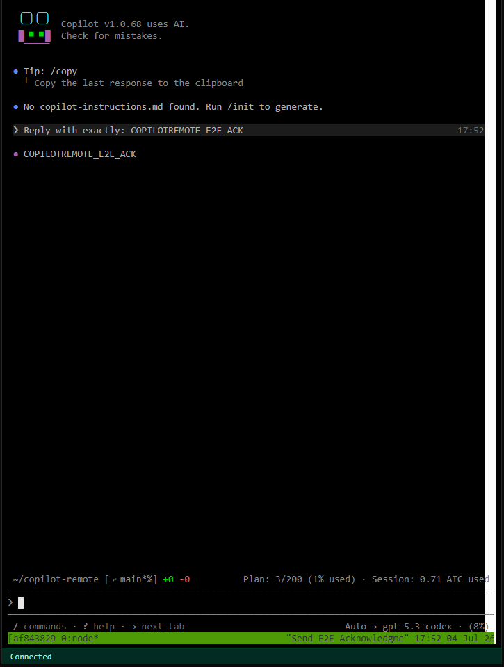
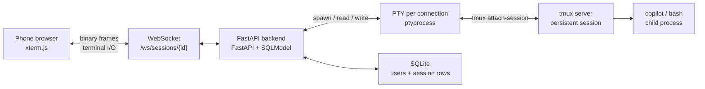

# Copilot Remote

Self-hosted web app for driving **GitHub Copilot CLI** from a phone over a
private Tailscale network. Copilot Remote is a *transparent terminal
transport*: it moves bytes between a real PTY and a WebSocket and never
inspects or parses Copilot's output. If Copilot adds a new slash command
tomorrow, it works remotely with zero changes to this app.



## Why

GitHub Copilot CLI is an interactive TUI: it draws a full-screen interface,
expects arrow keys, `Ctrl-C`, resizes, and slash commands. Wrapping it in a
chat-style API means reimplementing its semantics and keeping up with every
release. Instead, Copilot Remote puts the *real* terminal on the network:

* the CLI keeps running on your machine, in `tmux`, whether or not anyone is
  connected;
* the browser renders the terminal with `xterm.js` and forwards keystrokes;
* closing the browser tab, locking the phone, or losing Wi-Fi does not kill
  the session — reconnecting reattaches to the same `tmux` session.

This is a single-operator tool: it assumes one trusted user on a trusted
network, and it is designed to be reached over Tailscale rather than the
public internet. See [Security design](docs/security.md).

## Architecture



Two strictly separated layers:

| Layer | Lifetime | Responsibility |
|-------|----------|----------------|
| `tmux` session | persistent — owns the child process | keeps the CLI running across disconnects, browser reloads and backend restarts |
| PTY attached to `tmux attach-session` | transient — one per WebSocket connection | carries bytes for the currently connected browser |

Binary WebSocket frames carry raw terminal I/O; JSON text frames carry only
control messages (`resize`, `signal`, `ping`). Copilot's output is not parsed.

More detail: [docs/architecture.md](docs/architecture.md) (component map, PTY/tmux interaction, session lifecycle) and
[docs/api.md](docs/api.md) (REST endpoints, WebSocket protocol).

## Implemented features

| Capability | Where |
|------------|-------|
| Browser-based interactive terminal (`xterm.js` + `FitAddon`) | `frontend/src/components/Terminal.tsx` |
| Persistent `tmux` sessions that outlive the browser | `backend/app/pty_backend.py` |
| Terminal reconnection with exponential backoff and jitter (1s → 30s) | `frontend/src/hooks/useTerminal.ts` |
| Terminal resize (`ResizeObserver` + `SIGWINCH` through the PTY) | `useTerminal.ts`, `backend/app/pty_backend.py` |
| Thumb-friendly helper keys for mobile keyboards (Esc, Tab, Ctrl-C/Ctrl-D, arrows, `/`, Enter) | `frontend/src/components/MobileKeyboard.tsx` |
| Session lifecycle: create, list, stop, restart, delete | `backend/app/api.py`, `backend/app/session_manager.py` |
| Authentication: bcrypt passwords, signed session cookie, CSRF header check | `backend/app/auth.py` |
| Access control: repo and command allowlists, server-generated session UUIDs | `backend/app/config.py`, `backend/app/pty_backend.py` |
| Dashboard with live status, output preview and per-session health | `frontend/src/pages/DashboardPage.tsx` |
| PWA (installable, offline-cached shell) served from the backend | `frontend/vite.config.ts`, `backend/app/main.py` |
| Optional Tailscale Serve exposure and a systemd unit | [docs/deployment.md](docs/deployment.md) |

Optional deployment configurations (Tailscale, systemd) are *not* required to
run the app locally; the documented local invocations listen on
`127.0.0.1` only, and the backend serves the built SPA itself.

## Quickstart

Prerequisites: Python 3.12+, Node 20+, and `tmux`.
Use `bash` to try the terminal without provider access. To run `copilot`,
install and authenticate GitHub Copilot CLI separately as the backend user;
the app's local login is not a GitHub credential.

```bash
# 1. System packages (Debian/Ubuntu)
sudo apt-get install -y tmux python3.12 python3.12-venv nodejs npm

# 2. Backend
cd backend
python3.12 -m venv .venv && source .venv/bin/activate
pip install -e ".[dev]"

# 3. Configuration
cp ../config.example.yaml ./config.yaml
#   edit ./config.yaml: set session_secret, repos and commands
openssl rand -hex 32          # paste into session_secret

# 4. Create the first user
copilot-remote create-user

# 5. Start the backend (HTTP-only dev cookies; the Secure cookie flag
#    would otherwise be rejected by the browser over plain HTTP)
COPILOT_REMOTE_SECURE_COOKIES=false uvicorn app.main:app --host 127.0.0.1 --port 8000 --reload
```

In a second shell, start the frontend dev server (it proxies `/api` and `/ws`
to `127.0.0.1:8000`):

```bash
cd frontend
npm install
npm run dev        # http://localhost:5173
```

For a production-style local build, run `npm run build` in `frontend/` (output
lands in `backend/frontend_dist/`, which FastAPI serves) and run uvicorn
without `--reload`. Full instructions, configuration reference, Tailscale and
systemd setup are in [docs/deployment.md](docs/deployment.md).

## Security design in brief

Copilot Remote grants **shell access to the account that runs it**. The
security model is therefore "trusted operator on a trusted private network",
not "public multi-tenant service".

* Listen on `127.0.0.1` only and expose the app through Tailscale Serve
  (HTTPS to authenticated tailnet devices) rather than opening a port to the
  internet.
* `session_secret` must be at least 16 characters; generate it with
  `openssl rand -hex 32`. Changing it invalidates all outstanding cookies.
* Passwords are hashed with bcrypt (cost 12). The session cookie is
  `HttpOnly`, `Secure` in production and `SameSite=Strict`.
* State-changing REST calls except login require `X-Requested-With: copilot-remote-app`;
  unauthenticated WebSockets are accepted and immediately closed with code
  `1008`, without attaching a terminal.
* Repository paths and commands are checked against server-side allowlists;
  the `tmux` session name is always a server-generated UUID and never user
  input. All subprocess calls use argv lists — `shell=True` is forbidden and
  enforced by an AST scan in the test suite.

Known limitations (no audit has been performed, there is no rate limiting on
login, sessions are not isolated per user, and terminals inherit the
privileges of the service account) are documented in
[docs/security.md](docs/security.md).

## Documentation

| Page | Contents |
|------|----------|
| [docs/architecture.md](docs/architecture.md) | Component map, PTY/tmux layers, WebSocket transport, session lifecycle and status reconciliation |
| [docs/deployment.md](docs/deployment.md) | Installation, configuration reference, environment variables, Tailscale Serve, systemd, manual smoke test |
| [docs/security.md](docs/security.md) | Threat model, cookie/credential handling, WebSocket and terminal boundaries, limitations and deployment assumptions |
| [docs/api.md](docs/api.md) | REST endpoints, WebSocket wire protocol, request/response shapes |

## Validation

See [offline checks and manual smoke procedure](docs/deployment.md#verification).
CI runs backend pytest and frontend typecheck, tests and build on Python 3.12
and Node 20.

## Repository layout

```
backend/                 # Python 3.12+, FastAPI, SQLModel, ptyprocess, tmux
  app/                   # config, auth, api, websocket, pty_backend, session_manager, cli
  tests/                 # pytest suite (API, auth, CLI, config, PTY, WebSocket, shell safety)
frontend/                # React 18 + TS + Vite + Tailwind + xterm.js + vite-plugin-pwa
config.example.yaml      # example configuration
copilot-remote.service   # systemd unit
docs/                    # architecture, deployment, security, API reference
```

## Non-goals

* Not a Copilot wrapper or a GitHub API client.
* Not a multi-tenant SaaS, and not intended for public internet exposure.
* It transports raw terminal I/O and understands nothing about Copilot's
  output.

## License

Personal use, all rights reserved by the owner.
