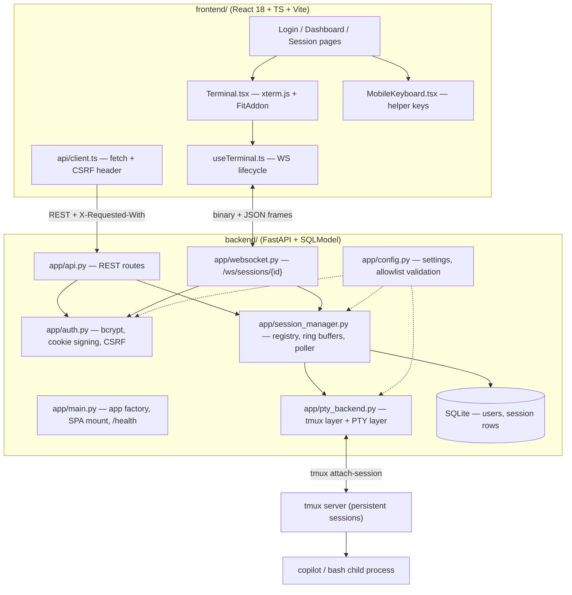
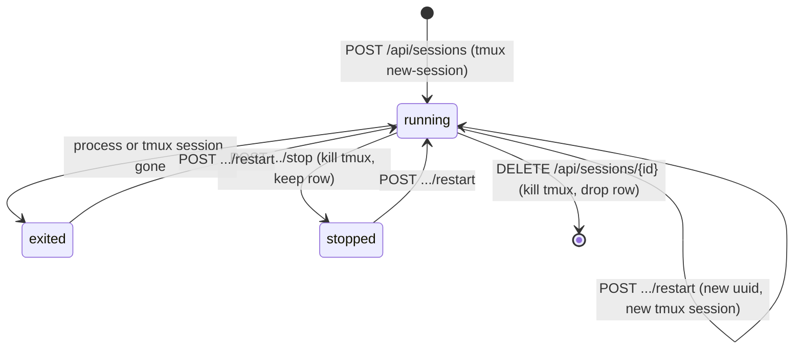

# Architecture

Copilot Remote is a terminal transport. It moves bytes between a browser and
a real PTY attached to a persistent `tmux` session, and it deliberately
understands nothing about the program running inside that session.

## Component map



## The two-layer PTY/tmux split

`backend/app/pty_backend.py` is explicitly split into two layers.

**tmux layer (persistent).** `create_session()`, `kill_session()`,
`is_alive()`, `is_process_alive()` and `list_sessions()` operate on `tmux`
session names. A session is created once, detached:

```
tmux new-session -d -s <uuid> -c <repo> <command>
```

The `tmux` server owns the child process. Because the session is detached,
the process keeps running when the browser goes away, when the network
drops, or when the backend itself is restarted.

**PTY layer (transient).** `connect()`, `resize()` and `disconnect()` are
called once per WebSocket connection:

```
tmux attach-session -t <uuid>        # spawned through ptyprocess.PtyProcess
```

The PTY is a *view* of the `tmux` session. Closing the PTY (or dropping the
WebSocket) tears down the view only; the `tmux` session and its child
process keep running.

Consequences:

* Reconnecting is a fresh `tmux attach-session`, not a session resume.
* Screen contents come from `tmux`, so a reconnect shows the current pane
  state rather than an empty screen.
* `resize()` sends `SIGWINCH` to the PTY so `tmux` (and therefore Copilot's
  TUI) learns about the new geometry.

## Backend

* **`app/main.py`** builds the FastAPI app. The lifespan hook initialises the
  SQLite schema and starts the session manager; shutdown stops the poller.
  If `backend/frontend_dist/` exists it is mounted as a single-page app with
  a catch-all fallback, so the backend serves the whole product on one port.
  A deliberately empty CORS policy (`allow_origins=[]`) reflects the
  single-origin design.
* **`app/api.py`** holds the REST routes. Session/config routes and
  `/api/auth/me` require a user. Logout only clears the cookie and requires
  the CSRF header; login requires neither. Mutating session routes require
  both authentication and the CSRF header.
* **`app/auth.py`** hashes passwords with bcrypt (cost 12) and signs the
  session cookie with `itsdangerous.TimestampSigner` using the configured
  `session_secret` and a fixed salt. Cookies older than 30 days are rejected
  as expired. Changing the salt string invalidates every outstanding cookie.
* **`app/session_manager.py`** is the in-process registry. It holds
  `LiveSession` objects (an in-memory mirror of the DB row plus runtime
  state), a per-session `asyncio.Lock`, a bounded output ring buffer and a
  single background status poller.
* **`app/config.py`** loads `config.yaml` (path overridable via
  `COPILOT_REMOTE_CONFIG`), overlays `COPILOT_REMOTE_*` environment
  variables, and provides `validate_repo()` / `validate_command()` for the
  allowlists.

## Frontend

* **`hooks/useTerminal.ts`** owns the whole WebSocket lifecycle for one
  session: creating the `xterm.js` terminal and the `FitAddon`, opening the
  socket, forwarding binary frames in both directions, handling JSON control
  frames, and reconnecting.
* **`components/Terminal.tsx`** renders the terminal plus a status line
  (`Connecting…` / `Connected` / `Reconnecting…` / error text).
* **`components/MobileKeyboard.tsx`** sends the escape sequences a phone
  keyboard cannot produce: `ESC [ A/B/C/D` for arrows, `\t`, `\r`, `\x1b`,
  `/`, and explicit Ctrl-C / Ctrl-D.
* **`api/client.ts`** wraps `fetch` with `credentials: "include"` and the
  `X-Requested-With: copilot-remote-app` header on every request.
* **`auth/AuthContext.tsx`** resolves the current user from
  `GET /api/auth/me` on mount and gates routes with `ProtectedRoute` /
  `PublicOnlyRoute`.

## Session lifecycle



Status values stored on the session row:

| Status | Meaning |
|--------|---------|
| `running` | the `tmux` session exists and the command process is alive |
| `exited` | the row persists but the command or `tmux` session has ended |
| `stopped` | the user stopped the session; the row is kept for status/history |
| `errored` | the backend could not create or attach the session cleanly |

### Startup reconciliation

On startup the session manager **hydrates** the registry from the database
and reconciles every row with the live `tmux` server:

* `tmux` session alive and process alive → `running`;
* `tmux` session alive but process dead → `exited`;
* no `tmux` session and the row said `running` → `exited`;
* rows explicitly `stopped` are left alone.

Any status change is written back to SQLite. This is what allows a browser
to reconnect to a session that was started before a backend restart. The
output ring buffers live in memory only, so the dashboard preview starts
fresh after a restart (the preview endpoint falls back to
`tmux capture-pane` when the buffer is empty).

### Concurrency model

* All mutations of a single session go through that session's
  `asyncio.Lock`.
* A registry-wide `asyncio.Lock` guards additions and removals.
* The status poller is a single background task, ticking every
  `session.status_poll_interval_seconds` (default 5s).
* Blocking `tmux`/`subprocess` calls are dispatched to a thread
  (`asyncio.to_thread`) so the event loop is never blocked.
* `session.multi_attach` decides the attach policy: `shared` (default)
  allows several browser tabs on one `tmux` session, `reject` refuses a
  second attachment.

## Transport details

* **Binary frames** carry terminal I/O in both directions and are forwarded
  verbatim — no protocol layer, no interpretation.
* **JSON text frames** carry control messages only: `resize`, `signal`,
  `ping` from the client; `pong`, `status`, `error` from the server.
* The client sends an initial `resize` immediately after the socket opens;
  the server defaults to 24x80 until it receives one.
* The client pings every 25 seconds (browsers have no native WebSocket
  ping) and the server replies `pong`.
* On any socket close the server closes the PTY and decrements the active
  connection count; the `tmux` session is untouched.

Full frame-by-frame details are in [api.md](api.md).

## Deliberate non-features

* The backend does not parse, filter or render Copilot output.
* There is no server-side session ownership model beyond the single-user
  assumption (see [security.md](security.md)).
* `idle_timeout_seconds` is declared in the configuration schema but is not
  yet enforced by the session manager; sessions currently live until they
  are stopped, restarted or deleted.
